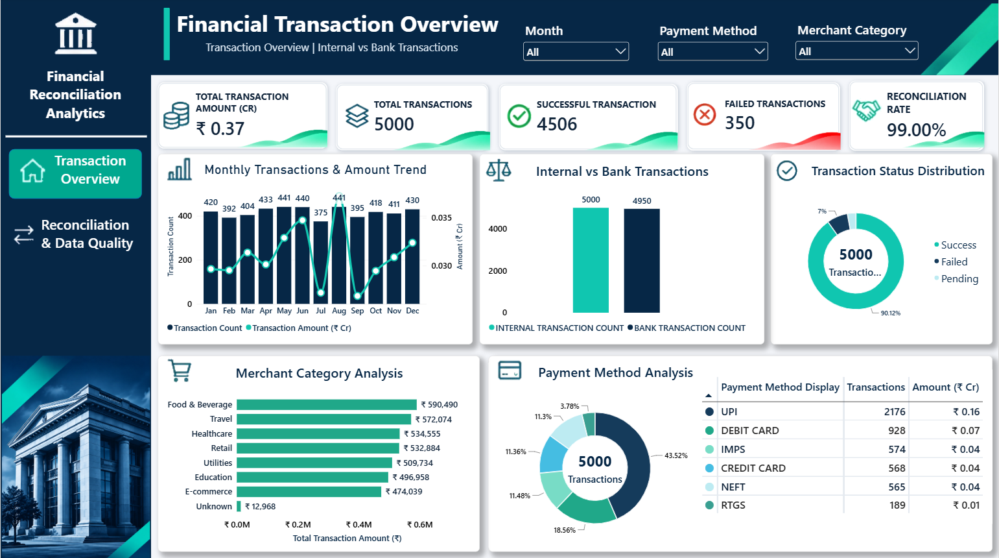
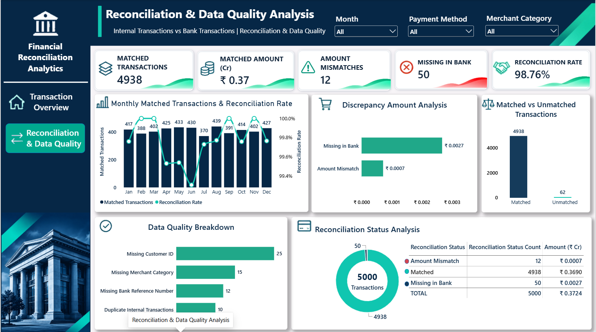

💳 Financial Transaction Reconciliation & Data Quality Analysis

An end-to-end data analytics project focused on reconciling internal financial transactions with bank records, identifying discrepancies, and evaluating data quality using Microsoft Excel, MySQL Workbench, and Power BI.

📌 Project Overview

Financial transaction reconciliation helps organizations maintain accurate financial records by identifying differences between internal transaction systems and bank statements.

This project analyzes 12 months of synthetic financial transaction data, from January to December 2026. It focuses on identifying missing transactions, amount mismatches, duplicate records, and incomplete data.

The project includes data preparation, SQL-based reconciliation, data validation, KPI development, and interactive Power BI dashboards.

🎯 Project Objectives

- Analyze internal and bank transaction records.
- Identify transactions missing from bank records.
- Detect amount mismatches between the two sources.
- Identify duplicate records and incomplete fields.
- Perform data quality checks and validation.
- Calculate financial reconciliation KPIs.
- Analyze monthly transaction trends and payment methods.
- Present business insights through interactive dashboards.

🛠️ Tools & Technologies

- Microsoft Excel
- MySQL Workbench
- Microsoft Power BI
- Power Query
- DAX
- SQL

📊 Dashboard Features

1. Financial Transaction Overview

Key Performance Indicators

- Total Transactions
- Total Transaction Amount
- Successful Transactions
- Failed Transactions
- Reconciliation Rate

Visualizations

- Monthly Transactions & Amount Trend
- Transaction Status Distribution
- Payment Method Analysis
- Merchant Category Analysis
- Internal vs Bank Transactions
  
2. Reconciliation & Data Quality Analysis

Key Performance Indicators

- Matched Transactions
- Matched Amount
- Amount Mismatches
- Missing in Bank
- Reconciliation Rate

Visualizations

- Monthly Matched Transactions & Reconciliation Rate
- Reconciliation Status Analysis
- Data Quality Breakdown
- Discrepancy Amount Analysis
- Matched vs Unmatched Transactions
  
📈 Key Performance Indicators

- Internal Transactions: 5,000
- Bank Transactions: 4,950
- Matched Transactions: 4,938
- Missing in Bank: 50
- Amount Mismatches: 12
- Exact-Match Reconciliation Rate: 98.76%
- Internal Transaction Success Rate: 90.12%

🔍 Key Business Insights

- 4,938 transactions were successfully matched between internal and bank records.
- 50 internal transactions were missing from bank records.
- 12 transactions had different amounts across the two sources.
- The exact-match reconciliation rate was 98.76%.
- 10 duplicate internal transaction rows were identified and removed during data preparation.
- Data quality checks identified 25 missing customer IDs, 15 missing merchant categories, and 12 missing bank reference numbers.

📁 Project Structure

Financial-Transaction-Reconciliation/
│
├── Excel/
│   └── Financial_Transaction_Cleaned_Data.xlsx
│
├── Dataset/
│   ├── Internal_Transactions_Clean_12M.csv
│   └── Bank_Transactions_Clean_12M.csv
│
├── SQL/
│   └── Financial_Transaction_Reconciliation.sql
│
├── Dashboard/
│   ├── Financial_Transaction_Dashboard.pbix
│   ├── Financial_Transaction_Overview.png
│   └── Reconciliation_Data_Quality.png
│
└── README.md

💡 Skills Demonstrated

Microsoft Excel

- Data inspection and preparation
- Data cleaning and standardization
- Duplicate identification
- Handling missing values
- Text and date formatting
- Data validation

MySQL Workbench

- SQL queries
- SELECT, WHERE and GROUP BY
- Joins and subqueries
- Aggregate functions
- Data validation
- Transaction reconciliation
- SQL views

Microsoft Power BI

- Power Query
- Data modeling
- DAX measures
- KPI development
- Interactive dashboards
- Data visualization
- Business reporting

Core Analytical Skills

- Data analysis
- Data quality analysis
- Problem solving
- Analytical thinking
- Business intelligence

⚠️ Dataset Disclaimer

The datasets used in this project are synthetic and created for educational and portfolio demonstration purposes. They do not contain real customer, merchant, or bank information.

👤 Author

Prithviraj Babar

GitHub: "Prithviraj Babar" (https://github.com/)

---
## Dashboard Previews

### 1. Financial Transaction Overview

### 2. Reconciliation & Data Quality Analysis

⭐ If you find this project useful, consider giving this repository a star!
